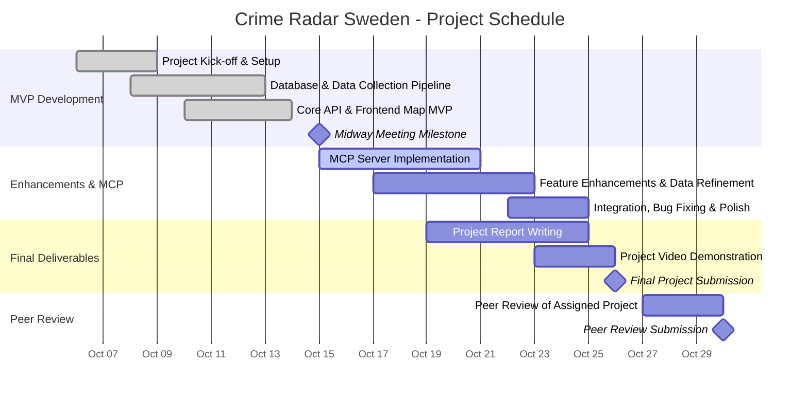

# Project Schedule & Gantt Chart

This document outlines the project schedule, phase milestones, and major deliverables for **Crime Radar Sweden**.

## Gantt Chart

---

## Generic Milestones

| Milestone | Date | Description | Status |
| :--- | :--- | :--- | :--- |
| **M1: Midway Meeting** | Oct 15, 2026 | Application MVP mostly complete (database ingestion, basic API, map frontend). Review project status. | Completed |
| **M2: Final Project Submission** | Oct 26, 2026 | Full implementation complete (including MCP server and functional refinements), accompanied by the 5-page project report and project video. | Scheduled |
| **M3: Peer Review Deadline** | Oct 30, 2026 | Complete and submit review of another team's project. | Scheduled |
